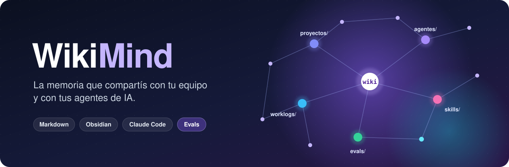
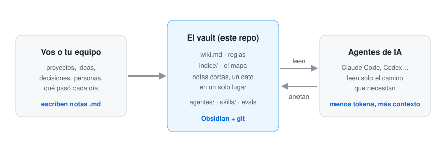
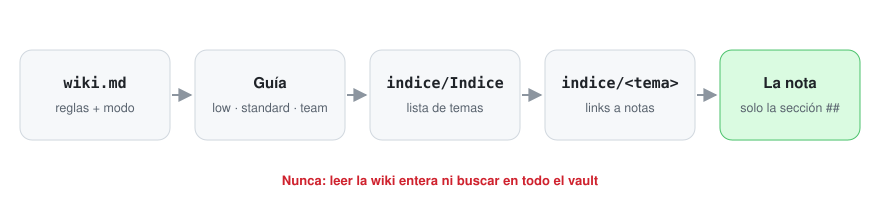
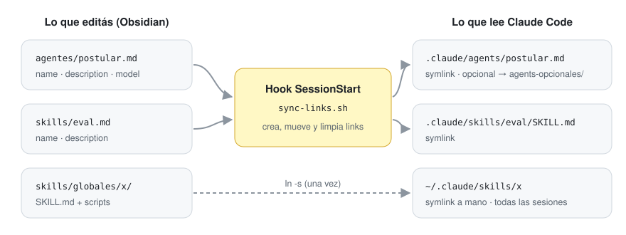
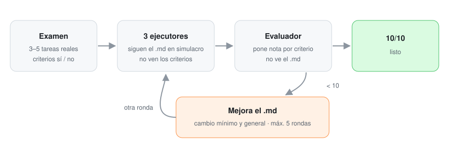

<p align="center"></p>

# WikiMind

Una wiki en Markdown para que vos (o tu equipo) y tus agentes de IA compartan **una sola memoria**. La abrís con Obsidian, la versionás con git y Claude Code, Codex o cualquier LLM la leen siguiendo un mapa, sin tener que leerla entera.



## Para qué sirve

- **Uso personal:** proyectos, ideas, estudios, decisiones y qué hiciste cada día, en un solo lugar que tu IA también entiende.
- **Uso en equipo:** cada persona y cada agente lee y escribe en la misma wiki con las mismas reglas (ver `guias/guia-team.md`).
- **Armar tus propios agentes y skills:** se guardan como notas, así que podés editarlos desde Obsidian y linkearlos con el resto.
- **Evaluar y mejorar skills:** cada skill tiene un examen con criterios de sí o no. La skill `eval` la corre, le pone nota y la corrige hasta que saque 10/10.

### Recomendado
1. Guardá cada skill o agente que funcione bien y armale su examen en `skills/evals/`.
2. Cuando algo que hizo una skill te sale mal, sumá esa queja como criterio al examen y corré `/eval <nombre>`.
3. Lo que no cambia va en notas durables. Lo que pasó va en `worklogs/`.

## Cómo lee un agente



`CLAUDE.md` y `AGENTS.md` mandan al agente a `wiki.md`. Ahí elige la guía del **modo activo**:

| Modo | Para quién |
|---|---|
| `low` | Planes baratos o pocos tokens |
| `standard` | Uso personal intensivo |
| `team` | Equipos con varias personas |

Además, `guias/backend-team.md` es un backend opcional para equipos grandes (permisos, muchos LLMs, miles de notas).

## Carpetas

```
wiki.md            reglas para agentes (lo primero que se lee)
indice/            el mapa: un índice por tema
conceptos/         qué es algo (teoría)
practicas/         cómo lo hacemos (arquitecturas, herramientas, estándares)
ideas/             ideas sueltas
proyectos/         una carpeta por proyecto, con su mini wiki
worklogs/          qué pasó cada día (append-only)
info-persistente/  personas y datos que no cambian
media/             assets 2D, 3D y contenido
plantillas/        nota, agente, skill, proyecto, persona
agentes/           tus agentes de Claude Code + scripts/sync-links.sh
skills/            tus skills
  evals/           un examen por skill o agente
  globales/        skills que valen en todas las carpetas
guias/             guías low, standard y team
```

## Empezar

1. Usá este repo como template (botón **Use this template**) o clonalo.
2. Abrí la carpeta como vault en [Obsidian](https://obsidian.md).
3. En `wiki.md`, cambiá el **modo activo**.
4. Creá los symlinks una vez:
   ```bash
   bash agentes/scripts/sync-links.sh
   ```
5. Abrí Claude Code en la carpeta. Desde ahí el hook se encarga de los symlinks.

## Agentes y skills con symlinks

Claude Code busca los agentes en `.claude/agents/` y las skills en `.claude/skills/<nombre>/SKILL.md`. Obsidian no muestra las carpetas que empiezan con punto. Por eso los archivos reales viven en `agentes/` y `skills/`, y en `.claude/` hay solo symlinks.



Los symlinks los crea `agentes/scripts/sync-links.sh`. Lo corre el hook `SessionStart` de `.claude/settings.json` cada vez que se abre una sesión. Como los genera, `.claude/agents/` y `.claude/skills/` están en `.gitignore`.

### Agregar un agente
1. Copiá `plantillas/agente.md` a `agentes/<nombre>.md`.
2. Completá `name`, `description` (cuándo usarlo) y `model`.
3. Abrí una sesión nueva: el agente ya aparece.
4. Sumalo a la tabla de `agentes/Index — Agentes.md`.

### Agregar una skill
1. Copiá `plantillas/skill.md` a `skills/<nombre>.md`.
2. Completá `name` y `description`.
3. Abrí una sesión nueva y usala con `/<nombre>`.
4. Armale su examen en `skills/evals/<nombre>.md`.

### Flags del frontmatter
- `opcional: true` → el symlink va a `.claude/agents-opcionales/` y su descripción no se carga en cada sesión (ahorra tokens). Para usar el agente, linkealo a mano:
  ```bash
  ln -sfn ../../agentes/<nombre>.md .claude/agents/<nombre>.md
  ```
- `sync: off` → no se linkea.

### Skill global (en todas las carpetas)
Creá `skills/globales/<nombre>/SKILL.md` y linkeala una vez:
```bash
ln -s "$PWD/skills/globales/<nombre>" ~/.claude/skills/<nombre>
```

## Qué trae de ejemplo

- `/nuevo-proyecto`: entrevista de arranque para cualquier proyecto (app, web, juego, API). Entrega un Brief y lo reparte en `proyectos/<P>/`.
- `/eval`: examina y mejora tus skills y agentes.
- `play-store`: auditoría de una app Android contra los requisitos de Google Play.
- `postular`: postula a avisos por mail o formulario. Viene apagado (`sync: off`) hasta que completes tus datos.

## Evals: skills que mejoran solas



```
/eval <nombre>
```

1. Si no hay examen, lo arma y te lo muestra antes de correr.
2. Tres subagentes hacen cada tarea en simulacro: no mandan, publican ni borran nada.
3. Un evaluador que no vio la skill pone nota por criterio.
4. Si la nota no es 10/10, corrige la causa en el `.md` y repite. Hace 5 rondas como máximo.

## Reglas de oro

- Un dato vive en un solo lugar; el resto linkea.
- Notas de 1000 palabras como máximo. Si pasa, se parte por tema y queda un hub.
- Toda nota nueva se linkea desde su índice.
- Nada de secretos: solo nombres de variables.

## Licencia

[MIT](LICENSE)
